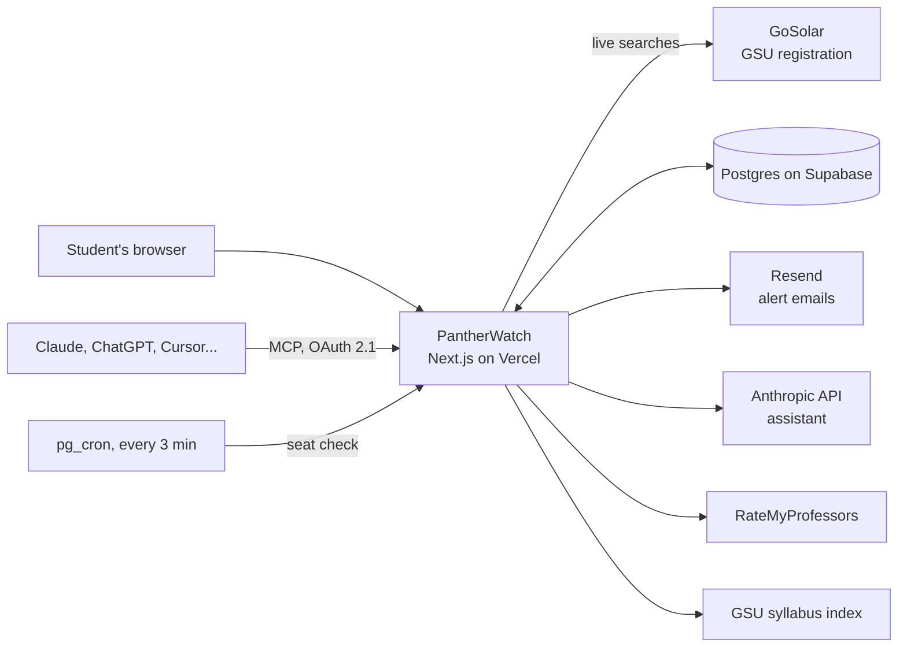

# PantherWatch

PantherWatch is a free website that helps Georgia State University students get into the classes
they need. It shows every section of a course with live seat counts from GoSolar, GSU's registration
system, next to the things GoSolar leaves out: how past students did with each professor, the
professor's RateMyProfessors rating, the syllabus, and the prerequisites. Track a full section and
PantherWatch emails you when a seat opens. It is live at **<https://www.pantherwatch.app>**.

PantherWatch is an independent student project by Raphael Omorose. It is not affiliated with or
endorsed by Georgia State University.

## Why it exists

Registration at GSU is a race. Popular sections fill within hours, many have no waitlist or a full
one, and the only way in is to catch a seat in the minutes after someone drops. In GoSolar that
means running the same search over and over, for days.

GoSolar also says little that helps you choose between sections: a time, a room and a name. Past
grades, student reviews, the syllabus and the registration restrictions all live on other sites, if
they are published at all.

PantherWatch puts that information on one page and does the refreshing for you.

## What it does

### Seat alerts

Click **Watch** on any section and PantherWatch checks it every three minutes. When a seat opens you
get an email with the section's details and a reminder to register in GoSolar. You get one email per
opening, not one every three minutes; [How seat alerts decide to
email](#how-seat-alerts-decide-to-email) explains the rules. Alerts need a Google sign-in, and
watches are cleared about two months after the term starts, when add/drop is long over.

### Course search and the course card

Pick a term, one or more subjects, optionally a few course numbers (`1301, 2720`), and a level:
Bachelor's, Associate (Perimeter College), Graduate or Law. Settings remembers your campus. Each
section appears as a card with live seats, enrollment and waitlist, the instructor, meeting days and
room, the professor's rating, and their average GPA in that course from past terms. You can filter
by days, open seats, honors, minimum rating or minimum GPA, and sort the results. Searching needs no
account.


Opening a card shows the section in full: grade history (average GPA, grade distribution and D/F/W
rate over past terms, for the course and for each professor who taught it), professor ratings with
the most common student tags, the syllabus, and the requirements.

### Requirements

The Requirements tab shows the section's catalog description, prerequisites, corequisites and
registration restrictions (majors, levels, cohorts) as GoSolar has them, with the prerequisite rules
turned into short readable chips. PantherWatch does not know your transcript, so it cannot tell you
whether you qualify; GoSolar checks that when you register.


### Schedule builder

Add sections to a weekly calendar for a term. Sections that overlap are flagged before you add them,
and the finished week exports as an `.ics` file for Google Calendar, Apple Calendar or Outlook.

### AI assistant

Signed-in students can ask questions in plain English on the AI Assistant page: "Is CSC 1301 open
next semester?", "Which MATH 1113 sections meet Tuesday and Thursday mornings?", "What does the
syllabus for CRN 19010 say about attendance?". The assistant is Claude, Anthropic's model, with the
same data as the site; it can also track sections and change your schedule when you ask. It helps
you pick between sections of a course you name, but it does not decide which courses count toward
your degree: that is your degree audit and advisor.


### Connect your own AI

If you already use Claude, ChatGPT, Cursor, VS Code, Claude Code or another assistant that supports
MCP connectors, you can add PantherWatch to it with the URL `https://www.pantherwatch.app/api/mcp`.
The Connect tab on the AI Assistant page walks through each app. You sign in to PantherWatch once
and choose what the app may do: read course data (always), manage your tracked classes, and edit
your schedule. You can disconnect an app at any time.


### Public API

Terms, subjects, section search, grade history, ratings, syllabi and requirements are available as
public JSON: no key, CORS enabled, and at most one request per second, please. The [developers
page](https://www.pantherwatch.app/developers) documents every endpoint with example responses.

## How it works

PantherWatch is one Next.js application (pages and API together) on Vercel, with a Postgres database
on Supabase.



**Live data.** Every course search goes straight to GoSolar, so seat counts are as current as
GoSolar's own. Nothing is scraped ahead of time.

**Stored data.** Postgres holds accounts, tracked sections, schedules and course details that
GoSolar does not have. Grade history comes from GSU's published grade-distribution reports: 13 terms
(Summer 2022 to Summer 2026) are committed in the repo, and an admin uploads each new term's export
because the source site blocks automated downloads. The syllabus index is copied daily from GSU's
public syllabus repository on cdn.gsu.edu. The course catalog (every course's title and
description, so the assistant can turn "calculus 2" into MATH 2212 without guessing) is copied
nightly from GoSolar's course catalog search. RateMyProfessors lookups are cached for a day, and a
professor is matched only when both last and first name agree, because a namesake's rating is worse
than none.

**Background work.** Vercel's free plan runs scheduled jobs at most once a day, which is too slow
for seat alerts. Instead, Supabase's `pg_cron` calls a protected route every three minutes. That
route groups all tracked sections by course, searches GoSolar once per course, and sends emails
through Resend. Daily jobs refresh the syllabus index and the course catalog, and clear out
finished terms.

**The assistant.** The chat sends your message to the server, which calls the Anthropic API. Claude
answers by calling PantherWatch's own tools (find a course by name, search sections, read
requirements, summarize a syllabus, track a section), and those tools run on the server as you.
Syllabus summaries are cached by the text of the syllabus and checked against the current PDF on
every request, so a changed syllabus gets a fresh summary. The conversation stays in your browser tab; the server keeps only
daily usage counts.

**Connected assistants.** Outside apps reach the same tools through an MCP server at `/api/mcp`.
PantherWatch is its own OAuth 2.1 authorization server: the app sends you to a consent page, you
approve the permissions, and the app gets a short-lived token that works only for your account.
Fourteen tools are shared between the connector and the on-site chat; the chat adds one more to save
your campus preference.

### How seat alerts decide to email

This is the heart of the product, so the rules are deliberate:

- **Open means a free seat and nobody waiting.** If students are on the waitlist, the seat goes to
  them, so PantherWatch does not email. For cross-listed sections the shared seat pool counts too.
- **One email per opening.** After an alert, the section has to be full for two checks in a row
  (about six minutes) before it can alert again. One "full" reading between two "open" ones is
  ignored, so a seat that flickers does not cause repeat emails.
- **Tracking an open section sends nothing.** You can register right now. You hear about it the next
  time it fills up and reopens.
- **Unknown is not full.** If GoSolar errors or the section is missing from the results, nothing
  changes.
- **A failed send is retried** on the next check.
- **Email has a daily budget.** The free email plan allows 100 emails a day and 3,000 a month, with
  the last 10 kept back for welcome and goodbye emails. If the budget runs out, open sections stay
  armed and are emailed once there is budget again.

### What it costs to run

PantherWatch costs nothing to host, and that is a design constraint rather than an accident: Vercel
Hobby, Supabase's free Postgres (500 MB), and Resend's free tier. Each seat check is kept short so
the three-minute schedule fits Vercel's free compute allowance.

The one paid service is the Anthropic API, for the assistant and syllabus summaries. It is capped:
40 messages per student per day, 800 messages site-wide, and an estimated $3 a day of spend
site-wide, all resetting at midnight Eastern. A syllabus summary costs about a tenth of a cent and
is generated once per syllabus version. Without an API key the assistant switches off and everything
else keeps working. Details are in [docs/runbooks/assistant.md](docs/runbooks/assistant.md).

## Limits and honesty

- **Not GSU.** PantherWatch is not affiliated with Georgia State University and is not an official
  source. GoSolar is the record.
- **It cannot register you.** An alert tells you a seat opened; you still register in GoSolar, and
  someone else may get there first.
- **Data changes.** Seats move constantly, and checks run every three minutes, so an alert can be a
  few minutes behind and the seat may be gone by the time you look.
- **Grade history is historical.** It covers past terms only, a new term appears after GSU publishes
  it and it is loaded, and a professor new to a course has none.
- **Ratings and syllabi depend on others.** A rating appears only when RateMyProfessors has a
  confident name match, and a syllabus only when the instructor uploaded one to GSU's public index.
- **The assistant can be wrong.** It is not an academic advisor. Check what it says in GoSolar and
  with your advisor before you rely on it. It has daily limits and may be switched off.
- **Privacy.** Sign-in is Google only; PantherWatch never sees a password. It stores your name,
  email, tracked sections, schedule and connected apps, and chat conversations are not stored on the
  server. See the [privacy policy](https://www.pantherwatch.app/privacy).

## Run it yourself

The quickest way needs Node 22 and the Postgres 17 server binaries, and no accounts or keys:

```sh
cd web
npm ci
npm run dev:local
```

That starts a local database with the grade history and a demo account, fakes the email service, and
serves the app on <http://localhost:3000> against the real GoSolar. Every other setup (Docker or
PGlite databases, Google sign-in, the assistant, cron) is in
[docs/runbooks/local-dev.md](docs/runbooks/local-dev.md). Environment variables, scripts, deployment
and the internals are in [web/README.md](web/README.md).

## Project layout

```text
web/                the app (Next.js)
  src/app/          pages and API routes
  src/lib/          GoSolar client, seat watcher, course data, assistant, MCP
  drizzle/          SQL migrations
  data/grade-csv/   GSU grade history, 13 terms
  tests/ e2e/       integration tests, Playwright end-to-end tests
docs/
  runbooks/         local dev, Vercel, Supabase cron, assistant budget
  audit-2026-10/    the audits behind the October 2026 rewrite
  design/           design spec, page specs, motion, tokens
  screenshots/      images used in this README
```

PantherWatch began as a Spring Boot API, a React single-page app and an Android client. In October
2026 they were replaced by the single Next.js app in `web/`; the reasoning is in
[docs/audit-2026-10/](docs/audit-2026-10/README.md).

## Testing philosophy

Tests exercise whole flows, not single functions. Integration tests call the real route handlers
with signed-in sessions, against an in-memory Postgres (PGlite) with the real migrations and a local
fake of GoSolar that reproduces its quirks. Playwright drives a real browser through the main pages.
Nothing of PantherWatch's own is mocked, and unit tests are kept for pure parsing code only. There
is no CI yet, so the [checks](web/README.md#scripts) are run by hand before every push.

## Contributing and feedback

Bug reports and ideas are welcome as [GitHub
issues](https://github.com/OfficialEseosa/panther-watch/issues), or by email to the address on the
site's [terms page](https://www.pantherwatch.app/terms). Before opening a pull request, read
[web/README.md](web/README.md) and run the checks.

## License

There is no license file yet. Until one is added, please ask before reusing the code.
